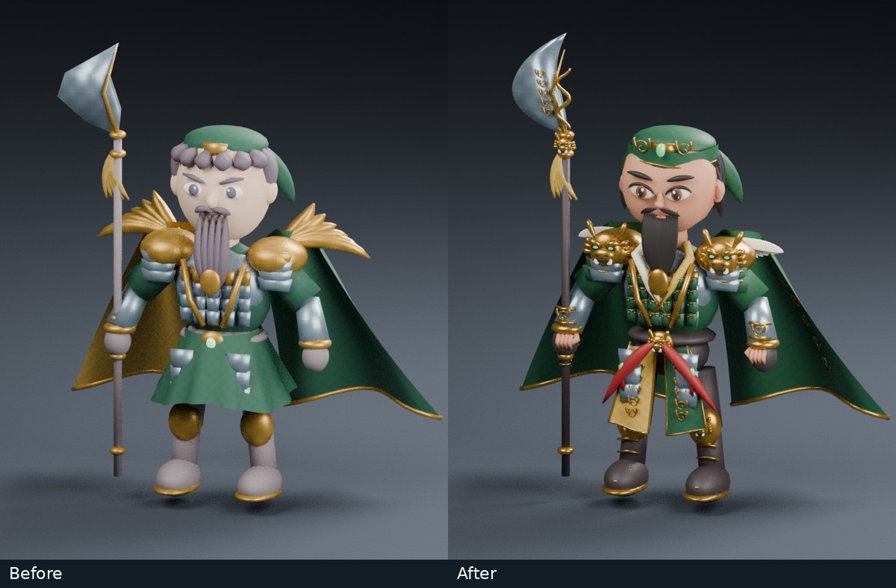
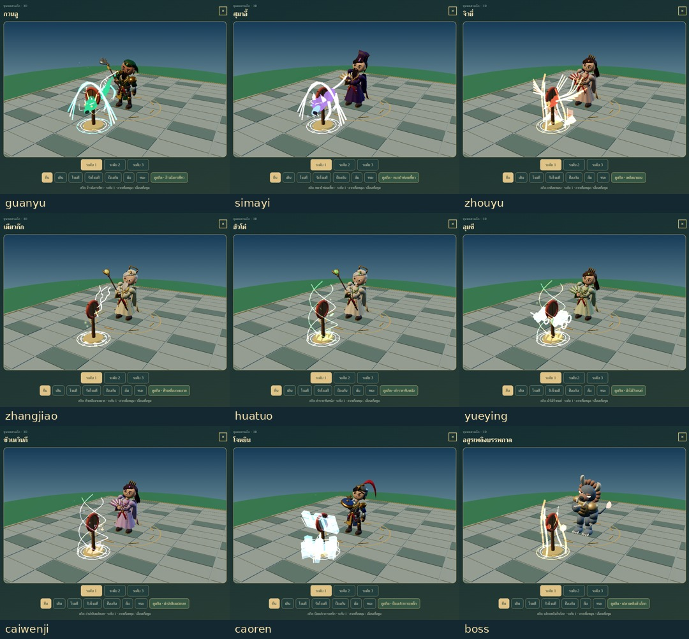
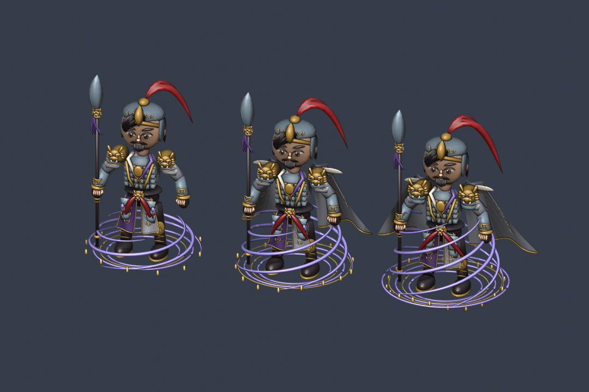

# ขุนพลสามก๊ก 3D — งานโมเดลรายละเอียด รุ่น 4

## [▶ เล่นเกมบนเว็บ](https://niasmin.github.io/3D/)

นำเกมจาก [niasmin/samkok](https://github.com/niasmin/samkok) มาปรับเป็นเกมเว็บ 3D ด้วยโมเดล Blender โดยใช้กติกาและระบบสะสมขุนพลเดิม

- **ขุนพลหลัก 5 คน:** เล่าปี่วัยหนุ่มดาบคู่ กวนอูง้าว เตียวหุยทวนงู จูล่งตามภาพต้นฉบับสีเขียว และขงเบ้งหมวกดำ–พัดขนนก พร้อมร่างวิวัฒน์ 3 ระดับ
- **แอนิเมชัน 7 ท่า:** ยืน เดิน โจมตี รับการโจมตี ป้องกัน พ่ายแพ้ และชนะ รวมทั้งบอสอสูร
- **วัสดุ:** UV พร้อมภาพพื้นผิวผ้าทอ ลายโลหะและ normal maps เก็บอยู่ใน `.blend` และ GLB
- **สกิลครบทุกตัว:** 64 ขุนพลและบอส มีลำดับร่าย–ปล่อย–กระทบ–จางหาย พร้อมมังกร พยัคฆ์ หมาป่า วิหคเพลิง สายฟ้า ดนตรีรักษา ม้าไม้วัวยนต์ และรูปแบบอื่นตามแต่ละสกิล ดูพรีวิวได้ทุกคน
- **มือถือ:** ปรับกล้อง ตัวหนังสือ แถบพลัง และเพิ่มโหมดคุณภาพอัตโนมัติ ยังเลือก Low / Standard / High เองได้
- **ออนไลน์:** เซฟคลาวด์แยกจากเกมเดิม แชตโลก/กิลด์ คู่ต่อสู้จากทัพผู้เล่นจริงแบบอัตโนมัติ รหัสย้ายเครื่องใช้ครั้งเดียว และหน้าจอเลือกเซฟเมื่อชนกัน พร้อมสำรองก่อนแทนที่



[รายการสกิลทั้ง 65 ชุด](docs/skills.md) · [รายละเอียดงานปั้นและขอบเขตความเหมือน](docs/sculpt-detail.md) · [ขุนพลในเกมรุ่นใหม่](samkok/artifacts/main-generals-v4.jpg)

[ภาพมือถือ](samkok/artifacts/battle-mobile.png) · [หน้าคลาวด์เซฟ](samkok/artifacts/cloud-online.png) · [ผลทดสอบและขอบเขต](samkok/three/README.md) · [การแยกข้อมูลออนไลน์](docs/online-security.md)



## เล่นและรันในเครื่อง

```sh
cd samkok
npm ci
npm run build
python3 -m http.server 8000 --directory web
```

เปิด `http://localhost:8000/` ใช้เบราว์เซอร์ที่รองรับ WebGL2 หากเปิด 3D ไม่ได้ เกมยังเล่นต่อด้วยภาพเดิมได้ เลือกโหมดออฟไลน์ได้จากหน้าบันทึกเกม

**บัญชีผู้เล่นเป็นบัญชีผู้เยี่ยมชมของเบราว์เซอร์นี้** ก่อนล้างข้อมูลเว็บหรือเปลี่ยนอุปกรณ์ ให้ใช้รหัสย้ายเครื่องหรือส่งออกรหัสเซฟ รหัสย้ายเครื่องใช้ได้ครั้งเดียวภายใน 20 นาที และเป็นการคัดลอกความคืบหน้าไปยังบัญชีของเครื่องรับ

**ขอบเขต:** ยังเป็นกราฟิกการ์ตูนที่ใช้โครงสร้างร่วมกันบางส่วน ไม่ใช่งานปั้นเหมือนภาพทุกจุด การ์ดและแผนที่เป็น UI 2D การประลองผู้เล่นเป็นแบบ asynchronous ไม่ใช่ co-op แบบเรียลไทม์ ผลการแข่งขันยังคำนวณจากเกมฝั่งผู้เล่น การทดสอบหน้าจอมือถือใช้ Chromium/SwiftShader; ยังไม่ได้วัด GPU บนโทรศัพท์จริง

ต้นฉบับนำเข้าที่ commit `b61a1fc66d6169e7aecf6de4ebf5870fbd8fa511` ดู [ข้อมูลต้นทาง](samkok/UPSTREAM.json)

---

## คลังโมเดล Blender

ชุดโมเดล 3D ตามภาพอ้างอิง Google Drive 69 ไฟล์ สำหรับเปิดแก้ไขใน Blender 4.3 ขึ้นไป

**สถานะ: เพิ่มรายละเอียดเรขาคณิตครบ 204 ร่าง / ความเหมือนทางศิลปะยังไม่ผ่านการตรวจรับ**

ภาพ 01–68 มีตัวละคร 3 ระดับต่อภาพ รวม **204 โมเดล** พร้อม rig และท่าพื้นฐาน Idle / Walk / Attack / Hit / Block / Defeat / Victory รวม 1,428 character actions และบอส 7 actions ส่วนภาพ 69 เป็นเอฟเฟกต์ 3 ระดับ รวมทั้งชุดมีเอฟเฟกต์เชิงนามธรรม 207 ชุดพร้อมการหมุนวน

โมเดลเป็นเรขาคณิต 3D มีความหนาและดูได้รอบตัว ไม่ใช้ภาพแบนแทนตัวละคร ตัวละครยังใช้ระบบโครงกระดูกและชิ้นส่วนพื้นฐานร่วมกัน แยกกลุ่มอัศวิน ขุนพล นักปราชญ์ นักธนู และนักรำ พร้อมสี อาวุธ เครื่องประดับและระดับพัฒนาตามการอ่านภาพอ้างอิง แต่ **ยังไม่ใช่งานปั้นรายละเอียดที่เหมือนต้นฉบับทุกตัว** เพิ่มรูปหน้าจากเส้นหน้าตัด ดวงตาทรงอัลมอนด์ เปลือกตา ช่อผมแบนปลายเรียว เคราหลายชั้น นิ้วมือ เกราะพร้อมหมุด ลายหน้าสัตว์ ขอบลายทอง และพู่หยกแล้ว แต่โครงสร้างพื้นฐานบางส่วนยังใช้ร่วมกัน และรายละเอียด/ลวดลายเฉพาะบุคคลยังไม่เหมือนภาพทุกจุด ด้านหลังเป็นการออกแบบเพิ่มเติมจากภาพด้านหน้า



[ดูภาพรวมทั้งชุด](previews/catalog.jpg) · [ด้านหน้า](previews/details/67-front.png) · [ด้านข้าง](previews/details/67-side.png) · [ด้านหลัง](previews/details/67-back.png) · [Idle รุ่นตั้งต้น](previews/idle.gif) · [Walk รุ่นตั้งต้น](previews/walk.gif) · [Attack รุ่นตั้งต้น](previews/attack.gif)

วิดีโอ GIF ข้างต้นเป็นตัวอย่างการทำงานของ rig รุ่นตั้งต้น ดูรูปลักษณ์ล่าสุดจากเกมและภาพเรนเดอร์หมายเลข

## เปิดใช้งาน

1. ดาวน์โหลด repository: **Code → Download ZIP** หรือ `git clone https://github.com/niasmin/3D.git`
2. เปิด `assets/01.blend` ถึง `assets/69.blend` ใน Blender 4.3+
3. ตัวละครระดับ 1 / 2 / 3 วางจากซ้ายไปขวา กด **Space** เพื่อเล่น Idle
4. เลือก rig ที่ลงท้าย `_Rig` แล้วเข้า **Pose Mode** เพื่อปรับท่า
5. เปลี่ยนท่าใน Action Editor เป็น action ที่ลงท้าย `__Idle`, `__Walk` หรือ `__Attack` ของ rig นั้น หรือเลือก text block `set_action.py` ที่แนบอยู่ในแต่ละไฟล์ (หรือเปิด `scripts/set_action.py`) ใน Text Editor แก้ `ACTION` แล้วกด Run Script เพื่อเปลี่ยนทุกตัวในฉาก
6. Idle มี 80 เฟรม, Walk 32 เฟรม, Attack 48 เฟรม ที่ 24 fps; ตั้งช่วง Timeline ให้ตรงท่า

ท่าของแต่ละตัวถูกเก็บใน Action และ muted NLA tracks ปิด NLA tracks ไว้เมื่อใช้ active Action เพื่อไม่ให้ซ้อนท่ากัน Walk เป็นการเดินอยู่กับที่ Attack แยกเป็นท่าพื้นฐานสำหรับดาบ ทวน ธนู และพัด/คทา ยังไม่ใช่ท่าเฉพาะตัวขุนพลทุกคน

## ไฟล์

| โฟลเดอร์ | เนื้อหา |
|---|---|
| `assets/` | 69 ไฟล์ `.blend` ตามภาพอ้างอิง และ `boss.blend` เพิ่มเติม แบบ compressed; ภาพอ้างอิง JPEG ถูก pack อยู่ในแต่ละไฟล์ |
| `previews/` | ภาพเรนเดอร์จาก geometry จริงใน Blender และภาพรวม |
| `references/` | ภาพอ้างอิงย่อจากต้นฉบับ 69 PNG เป็น JPEG; ต้นฉบับอยู่ใน Drive |
| `scripts/` | สคริปต์สร้างชุดโมเดล เปลี่ยน action ตรวจไฟล์ และเรนเดอร์ตัวอย่าง |
| `docs/` | รายการโมเดลและรายงานตรวจสอบทางเทคนิค |

## ขอบเขตและสิ่งที่ยังต้องปรับ

- Rig 22 bones ต่อ character; mesh ใช้การถ่วงน้ำหนักแยกชิ้นตามกระดูก ไม่มี finger rig, facial rig, IK หรือ retarget profile
- เสื้อคลุมและพู่ขยับด้วยกระดูก; ไม่มี cloth/hair simulation
- วัสดุใช้ Principled shaders และ UV พร้อมภาพลายผ้า/โลหะและ normal maps แบบสร้างด้วยโค้ด; ยังไม่ใช่ชุด texture ที่วาดมือรายตัว
- ชิ้นส่วนมีการซ้อนและแยกผิวตามการประกอบแบบ stylized; ไม่ใช่ผิวต่อเนื่องสำหรับงานปั้นหรือการพิมพ์ 3D
- เอฟเฟกต์เป็นวงเวทและเกลียว 3D แบบนามธรรมตามสีในภาพ ยังไม่ได้จำลองสัตว์ อักษร หรือเส้นเปลวไฟของแต่ละต้นฉบับ
- ไม่รวมการทดสอบใน Unity / Unreal หรือการรับรองว่า game-ready
- Render พรีวิวใช้ Workbench เพื่อดูฟอร์มและสี มีไฟสำหรับเปลี่ยนไปใช้ Eevee / Cycles อยู่ในฉากแล้ว แสง emission จะต้องใช้ render engine ที่รองรับ

## สร้างซ้ำ

```bash
blender -b -t 4 --python scripts/build_library.py -- --start 1 --end 69
blender -b -t 4 --python scripts/validate_library.py
```

ไม่ต้องติดตั้ง add-on หรือ Python package ภายนอก สร้างซ้ำจะเขียนทับไฟล์หมายเลขที่เลือก ควรสำรองงานที่แก้เองก่อน

## ผลตรวจ

**ผ่านการตรวจทางเทคนิค:** เปิดกลับครบ 69 ไฟล์ ภาพอ้างอิงคงอยู่ครบ ตรวจ deformation 1,428 actions และแกนหมุน 207 เอฟเฟกต์

ดู [รายงานตรวจสอบ](docs/validation.json) สำหรับการเปิดไฟล์กลับ การ pack ภาพ น้ำหนักกระดูก และการวัด vertex displacement จาก action จริง การตรวจนี้ไม่ยืนยันความเหมือนภาพหรือคุณภาพเชิงศิลป์

## รายการทั้งหมด

| ภาพ | ชื่อใช้งานในชุดนี้ | โมเดล | พรีวิว | ภาพอ้างอิง |
|---|---|---|---|---|
| 01 | Silver Phoenix | [.blend](assets/01.blend) | [render](previews/01.png) | [reference](references/01.jpg) |
| 02 | Crimson Vanguard | [.blend](assets/02.blend) | [render](previews/02.png) | [reference](references/02.jpg) |
| 03 | Jade Chancellor | [.blend](assets/03.blend) | [render](previews/03.png) | [reference](references/03.jpg) |
| 04 | Verdant Immortal | [.blend](assets/04.blend) | [render](previews/04.png) | [reference](references/04.jpg) |
| 05 | Violet Archer | [.blend](assets/05.blend) | [render](previews/05.png) | [reference](references/05.jpg) |
| 06 | Crimson Warlord | [.blend](assets/06.blend) | [render](previews/06.png) | [reference](references/06.jpg) |
| 07 | Scarlet Cavalier | [.blend](assets/07.blend) | [render](previews/07.png) | [reference](references/07.jpg) |
| 08 | Ivory Veteran | [.blend](assets/08.blend) | [render](previews/08.png) | [reference](references/08.jpg) |
| 09 | Golden Envoy | [.blend](assets/09.blend) | [render](previews/09.png) | [reference](references/09.jpg) |
| 10 | Flame Sentinel | [.blend](assets/10.blend) | [render](previews/10.png) | [reference](references/10.jpg) |
| 11 | Amber Veteran | [.blend](assets/11.blend) | [render](previews/11.png) | [reference](references/11.jpg) |
| 12 | Blood Spear | [.blend](assets/12.blend) | [render](previews/12.png) | [reference](references/12.jpg) |
| 13 | Peony Dancer | [.blend](assets/13.blend) | [render](previews/13.png) | [reference](references/13.jpg) |
| 14 | Ember Lion | [.blend](assets/14.blend) | [render](previews/14.png) | [reference](references/14.jpg) |
| 15 | Azure Lancer | [.blend](assets/15.blend) | [render](previews/15.png) | [reference](references/15.jpg) |
| 16 | Flame Blades | [.blend](assets/16.blend) | [render](previews/16.png) | [reference](references/16.jpg) |
| 17 | River Strategist | [.blend](assets/17.blend) | [render](previews/17.png) | [reference](references/17.jpg) |
| 18 | Moon Scholar | [.blend](assets/18.blend) | [render](previews/18.png) | [reference](references/18.jpg) |
| 19 | Azure Guard | [.blend](assets/19.blend) | [render](previews/19.png) | [reference](references/19.jpg) |
| 20 | Golden Shield | [.blend](assets/20.blend) | [render](previews/20.png) | [reference](references/20.jpg) |
| 21 | Tide Chancellor | [.blend](assets/21.blend) | [render](previews/21.png) | [reference](references/21.jpg) |
| 22 | Crimson Lady | [.blend](assets/22.blend) | [render](previews/22.png) | [reference](references/22.jpg) |
| 23 | Lion Admiral | [.blend](assets/23.blend) | [render](previews/23.png) | [reference](references/23.jpg) |
| 24 | Inferno Dancer | [.blend](assets/24.blend) | [render](previews/24.png) | [reference](references/24.jpg) |
| 25 | Mountain Guardian | [.blend](assets/25.blend) | [render](previews/25.png) | [reference](references/25.jpg) |
| 26 | Phoenix Duelist | [.blend](assets/26.blend) | [render](previews/26.png) | [reference](references/26.jpg) |
| 27 | Bamboo Maiden | [.blend](assets/27.blend) | [render](previews/27.png) | [reference](references/27.jpg) |
| 28 | Storm Ranger | [.blend](assets/28.blend) | [render](previews/28.png) | [reference](references/28.jpg) |
| 29 | Jade Ranger | [.blend](assets/29.blend) | [render](previews/29.png) | [reference](references/29.jpg) |
| 30 | Dark Regent | [.blend](assets/30.blend) | [render](previews/30.png) | [reference](references/30.jpg) |
| 31 | Forest Ranger | [.blend](assets/31.blend) | [render](previews/31.png) | [reference](references/31.jpg) |
| 32 | Sky Halberd | [.blend](assets/32.blend) | [render](previews/32.png) | [reference](references/32.jpg) |
| 33 | Ruby Blades | [.blend](assets/33.blend) | [render](previews/33.png) | [reference](references/33.jpg) |
| 34 | Jade Serpent | [.blend](assets/34.blend) | [render](previews/34.png) | [reference](references/34.jpg) |
| 35 | Cloud Maiden | [.blend](assets/35.blend) | [render](previews/35.png) | [reference](references/35.jpg) |
| 36 | Violet Chancellor | [.blend](assets/36.blend) | [render](previews/36.png) | [reference](references/36.jpg) |
| 37 | Night Scholar | [.blend](assets/37.blend) | [render](previews/37.png) | [reference](references/37.jpg) |
| 38 | Red Commander | [.blend](assets/38.blend) | [render](previews/38.png) | [reference](references/38.jpg) |
| 39 | Spring Maiden | [.blend](assets/39.blend) | [render](previews/39.png) | [reference](references/39.jpg) |
| 40 | Ocean Champion | [.blend](assets/40.blend) | [render](previews/40.png) | [reference](references/40.jpg) |
| 41 | Elder Archer | [.blend](assets/41.blend) | [render](previews/41.png) | [reference](references/41.jpg) |
| 42 | Lilac Princess | [.blend](assets/42.blend) | [render](previews/42.png) | [reference](references/42.jpg) |
| 43 | Azure Dragon | [.blend](assets/43.blend) | [render](previews/43.png) | [reference](references/43.jpg) |
| 44 | Emerald Elder | [.blend](assets/44.blend) | [render](previews/44.png) | [reference](references/44.jpg) |
| 45 | Forest Scholar | [.blend](assets/45.blend) | [render](previews/45.png) | [reference](references/45.jpg) |
| 46 | Amethyst Bulwark | [.blend](assets/46.blend) | [render](previews/46.png) | [reference](references/46.jpg) |
| 47 | Jade Huntress | [.blend](assets/47.blend) | [render](previews/47.png) | [reference](references/47.jpg) |
| 48 | Jade Dragon | [.blend](assets/48.blend) | [render](previews/48.png) | [reference](references/48.jpg) |
| 49 | Emerald Cavalier | [.blend](assets/49.blend) | [render](previews/49.png) | [reference](references/49.jpg) |
| 50 | Ivory Commander | [.blend](assets/50.blend) | [render](previews/50.png) | [reference](references/50.jpg) |
| 51 | Jade Duelist | [.blend](assets/51.blend) | [render](previews/51.png) | [reference](references/51.jpg) |
| 52 | Lilac Immortal | [.blend](assets/52.blend) | [render](previews/52.png) | [reference](references/52.jpg) |
| 53 | Sun Immortal | [.blend](assets/53.blend) | [render](previews/53.png) | [reference](references/53.jpg) |
| 54 | Royal Tide | [.blend](assets/54.blend) | [render](previews/54.png) | [reference](references/54.jpg) |
| 55 | Fire Monarch | [.blend](assets/55.blend) | [render](previews/55.png) | [reference](references/55.jpg) |
| 56 | Scarlet Princess | [.blend](assets/56.blend) | [render](previews/56.png) | [reference](references/56.jpg) |
| 57 | Frost Monarch | [.blend](assets/57.blend) | [render](previews/57.png) | [reference](references/57.jpg) |
| 58 | Midnight Minister | [.blend](assets/58.blend) | [render](previews/58.png) | [reference](references/58.jpg) |
| 59 | Jade Minister | [.blend](assets/59.blend) | [render](previews/59.png) | [reference](references/59.jpg) |
| 60 | Garden Princess | [.blend](assets/60.blend) | [render](previews/60.png) | [reference](references/60.jpg) |
| 61 | Bronze Bulwark | [.blend](assets/61.blend) | [render](previews/61.png) | [reference](references/61.jpg) |
| 62 | Violet Princess | [.blend](assets/62.blend) | [render](previews/62.png) | [reference](references/62.jpg) |
| 63 | Sage of Jade | [.blend](assets/63.blend) | [render](previews/63.png) | [reference](references/63.jpg) |
| 64 | Emerald Crescent | [.blend](assets/64.blend) | [render](previews/64.png) | [reference](references/64.jpg) |
| 65 | Inferno Crescent | [.blend](assets/65.blend) | [render](previews/65.png) | [reference](references/65.jpg) |
| 66 | Ivory Sage | [.blend](assets/66.blend) | [render](previews/66.png) | [reference](references/66.jpg) |
| 67 | Jade War God | [.blend](assets/67.blend) | [render](previews/67.png) | [reference](references/67.jpg) |
| 68 | Crimson War God | [.blend](assets/68.blend) | [render](previews/68.png) | [reference](references/68.jpg) |
| 69 | Emerald Vortex Effects | [.blend](assets/69.blend) | [render](previews/69.png) | [reference](references/69.jpg) |

ชื่อภาษาอังกฤษเป็นชื่อจัดหมวดที่สร้างขึ้นสำหรับ repository นี้ ไม่ใช่ชื่ออย่างเป็นทางการของตัวละครต้นฉบับ

อ้างอิง: https://drive.google.com/file/d/1PuUqShJXCPb7VXqTtUl1S-mx5qSRa51o/view

สิทธิ์ในภาพและแบบตัวละครต้นฉบับยังเป็นของเจ้าของเดิม Repository นี้ไม่ได้มอบสิทธิ์ในต้นฉบับเพิ่มเติม
