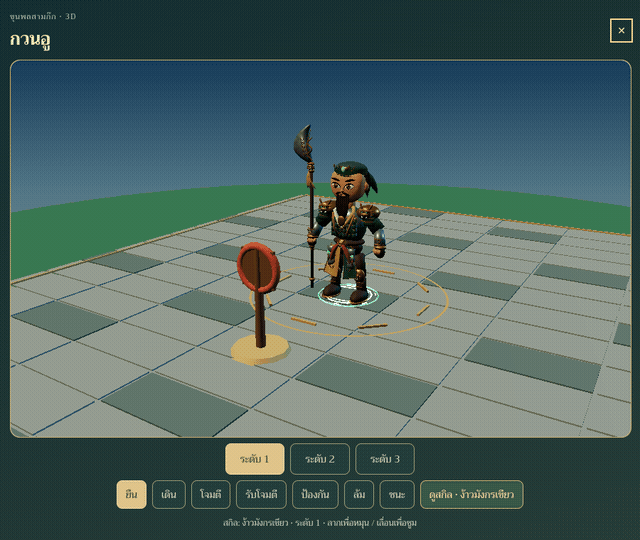

# เอฟเฟกต์สกิลเฉพาะตัว — รุ่น 1

ครอบคลุมขุนพลเล่นได้ 64 คนและบอส 1 ตัว ใช้สูตรเอฟเฟกต์ที่แตกต่างกัน 65 ชุด
ตามชื่อสกิลและธีมภาพอ้างอิง รูปทรงเป็นเรขาคณิต 3D สร้างใน Three.js ประกอบกับโมเดล
Blender เดิม มีลำดับร่าย → ปล่อยพลัง → โดนเป้าหมาย → จางหาย และดูตัวอย่างได้จาก
ปุ่ม **ดูสกิล** ของขุนพลทุกคน รวมถึงบอส

ระบบต่อสู้เรียกเอฟเฟกต์โดนเป้าหมายใน callback เดียวกับที่ปรับเลือด (30% ของจังหวะโจมตี)
สกิลหมู่สร้างผลกระทบตรงทุกเป้าหมายจริง สกิลรักษายึดช่อง heal ของผลคำนวณ ไม่เดาฝ่าย
จากสีหรือรูปลักษณ์ ตัวอย่างในหน้าขุนพลใช้เป้าสาธิตและไม่เปลี่ยนเซฟหรือเลือดผู้เล่น

ระดับวิวัฒน์เพิ่มขนาด จำนวนองค์ประกอบและอนุภาค โหมด Low ลดรายละเอียดและเหลือ
สกิลพร้อมกันสูงสุดหนึ่งชุด; Standard สูงสุดสามชุด เมื่อถึงขีดจำกัดจะล้างชุดเก่าก่อน
โหมดลดการเคลื่อนไหวใช้วงสัญลักษณ์นิ่ง ไม่ปล่อยพลังวิ่งหรืออนุภาค และจางหายเร็วขึ้น
พื้นเรืองแสงและชิ้นส่วนทั้งหมดถูกคืนทรัพยากรเมื่อจบสกิล เปลี่ยนระดับ หรือปิดหน้าขุนพล

[ภาพรวมครบ 65 ชุด](../samkok/artifacts/skills-catalog.jpg) · [ตัวอย่างจากเกมจริง](../samkok/artifacts/skills-showcase.jpg)

## รายการครบทุกตัว

| ขุนพล | สกิล | รูปแบบหลัก | ภาพจาก WebGL |
|---|---|---|---|
| เล่าปี่วัยหนุ่ม | ปณิธานใต้ต้นท้อ | ดาบคู่ | [ดูภาพ](../samkok/artifacts/skills/liubei_y.png) |
| กวนอูวัยหนุ่ม | ง้าวพเนจร | ง้าวโค้ง | [ดูภาพ](../samkok/artifacts/skills/guanyu_y.png) |
| เตียวหุยวัยหนุ่ม | คำรามแห่งตุ้นก้วน | คลื่นคำราม | [ดูภาพ](../samkok/artifacts/skills/zhangfei_y.png) |
| กวนอู | ง้าวมังกรเขียว | มังกร | [ดูภาพ](../samkok/artifacts/skills/guanyu.png) |
| ขงเบ้ง | ลมบูรพาเผาทัพ | ลมหมุน | [ดูภาพ](../samkok/artifacts/skills/zhuge.png) |
| จูล่ง | ฝ่าทัพทุ่งเตียงปัน | ทวนพลังงาน | [ดูภาพ](../samkok/artifacts/skills/zhaoyun.png) |
| เล่าปี่ | คุณธรรมรวมใจ | ดาบคู่ | [ดูภาพ](../samkok/artifacts/skills/liubei.png) |
| ม้าเฉียว | ทวนม้าเหล็กแดนตะวันตก | กองทัพม้า | [ดูภาพ](../samkok/artifacts/skills/machao.png) |
| เตียวหุย | คำรามสะท้านสะพาน | คลื่นคำราม | [ดูภาพ](../samkok/artifacts/skills/zhangfei.png) |
| ฮองตง | ศรเขาเตงกุนสัน | ห่าศร | [ดูภาพ](../samkok/artifacts/skills/huangzhong.png) |
| โจโฉ | วีรบุรุษกลียุค | คมดาบ | [ดูภาพ](../samkok/artifacts/skills/caocao.png) |
| สุมาอี้ | หมาป่าซ่อนเขี้ยว | หมาป่า | [ดูภาพ](../samkok/artifacts/skills/simayi.png) |
| เตียวเลี้ยว | แปดร้อยทลายหับป๋า | กองทัพม้า | [ดูภาพ](../samkok/artifacts/skills/zhangliao.png) |
| แฮหัวตุ้น | ตาเดียวไม่ถอย | ง้าวโค้ง | [ดูภาพ](../samkok/artifacts/skills/xiahoudun.png) |
| เคาทู | พยัคฆ์คลั่ง | พยัคฆ์ | [ดูภาพ](../samkok/artifacts/skills/xuchu.png) |
| เตียนอุย | คู่ง้าวพิทักษ์นาย | ขวานคู่ | [ดูภาพ](../samkok/artifacts/skills/dianwei.png) |
| ซุนฮก | แผนบำรุงทัพ | สมุนไพร | [ดูภาพ](../samkok/artifacts/skills/xunyu.png) |
| จิวยี่ | เพลิงผาแดง | วิหคเพลิง | [ดูภาพ](../samkok/artifacts/skills/zhouyu.png) |
| ซุนกวน | ประมุขกังตั๋ง | พยัคฆ์ | [ดูภาพ](../samkok/artifacts/skills/sunquan.png) |
| ซุนซ่างเซียง | ศรวิหคชาด | วิหคเพลิง | [ดูภาพ](../samkok/artifacts/skills/sunshangxiang.png) |
| ลิบอง | ทัพเสื้อขาวข้ามน้ำ | กองทัพม้า | [ดูภาพ](../samkok/artifacts/skills/lumeng.png) |
| กำเหลง | ปล้นค่ายร้อยม้า | ห่าศร | [ดูภาพ](../samkok/artifacts/skills/ganning.png) |
| ไต้เกี้ยว | บทเพลงสายน้ำ | โน้ตดนตรี | [ดูภาพ](../samkok/artifacts/skills/daqiao.png) |
| ลิโป้ | เทพสงครามบนหลังเซ็กเธาว์ | กองทัพม้า | [ดูภาพ](../samkok/artifacts/skills/lubu.png) |
| เตียวเสี้ยน | ระบำจันทร์ลวงใจ | กลีบดอกไม้ | [ดูภาพ](../samkok/artifacts/skills/diaochan.png) |
| ตั๋งโต๊ะ | ทรราชลั่นกลอง | อุกกาบาตเพลิง | [ดูภาพ](../samkok/artifacts/skills/dongzhuo.png) |
| อ้วนเสี้ยว | ห่าศรแห่งกิจิ๋ว | ห่าศร | [ดูภาพ](../samkok/artifacts/skills/yuanshao.png) |
| ฮัวโต๋ | ตำรายาชิงหนัง | สมุนไพร | [ดูภาพ](../samkok/artifacts/skills/huatuo.png) |
| กุยแก | อุบายสิบชนะ | ผลึก | [ดูภาพ](../samkok/artifacts/skills/guojia.png) |
| โจผี | จักรพรรดิแห่งวุย | คมดาบ | [ดูภาพ](../samkok/artifacts/skills/caopi.png) |
| เอียนสี | เทพธิดาแม่น้ำลั่ว | สายน้ำ | [ดูภาพ](../samkok/artifacts/skills/zhenji.png) |
| ซิหลง | ขวานทลายวงล้อม | ขวานคู่ | [ดูภาพ](../samkok/artifacts/skills/xuhuang.png) |
| โจหยิน | ป้อมปราการเหล็ก | ปราการ | [ดูภาพ](../samkok/artifacts/skills/caoren.png) |
| บังทอง | กลห่วงโซ่เรือ | โซ่ | [ดูภาพ](../samkok/artifacts/skills/pangtong.png) |
| เกียงอุย | สืบทอดเจตนาขงเบ้ง | ทวนพลังงาน | [ดูภาพ](../samkok/artifacts/skills/jiangwei.png) |
| กวนอิ๋นผิง | ทวนพยัคฆ์สาว | พยัคฆ์ | [ดูภาพ](../samkok/artifacts/skills/guanyinping.png) |
| อุยซี | ม้าไม้วัวยนต์ | ม้าไม้วัวยนต์ | [ดูภาพ](../samkok/artifacts/skills/yueying.png) |
| อุยเอี๋ยน | ทางลัดหุบจื่ออู่ | ง้าวโค้ง | [ดูภาพ](../samkok/artifacts/skills/weiyan.png) |
| ซุนเซ็ก | เจ้าน้อยแห่งกังตั๋ง | พยัคฆ์ | [ดูภาพ](../samkok/artifacts/skills/sunce.png) |
| ลกซุน | เพลิงเผาค่ายอิเหลง | เพลิง | [ดูภาพ](../samkok/artifacts/skills/luxun.png) |
| ไทสูจู้ | ศรคู่ทวนเดี่ยว | ทวนพลังงาน | [ดูภาพ](../samkok/artifacts/skills/taishici.png) |
| อุยกาย | กลยอมเจ็บ | เรือไฟ | [ดูภาพ](../samkok/artifacts/skills/huanggai.png) |
| โลซก | ไมตรีสองแคว้น | สายน้ำ | [ดูภาพ](../samkok/artifacts/skills/lusu.png) |
| เตียวก๊ก | ฟ้าเหลืองจะผงาด | สายฟ้า | [ดูภาพ](../samkok/artifacts/skills/zhangjiao.png) |
| เบ้งเฮ็ก | เจ็ดจับเจ็ดปล่อย | ช้างศึก | [ดูภาพ](../samkok/artifacts/skills/menghuo.png) |
| นางจูหยง | มีดบินเทพไฟ | มีดบิน | [ดูภาพ](../samkok/artifacts/skills/zhurong.png) |
| กองซุนจ้าน | ทหารม้าขาว | กองทัพม้า | [ดูภาพ](../samkok/artifacts/skills/gongsunzan.png) |
| อ้วนสุด | ตราหยกแผ่นดิน | ตราหยก | [ดูภาพ](../samkok/artifacts/skills/yuanshu.png) |
| ซุนเกียน | พยัคฆ์แห่งกังตั๋ง | พยัคฆ์ | [ดูภาพ](../samkok/artifacts/skills/sunjian.png) |
| จอจู้ | เวทมายาแปรร่าง | ยันต์ | [ดูภาพ](../samkok/artifacts/skills/zuoci.png) |
| เตงงาย | ข้ามเขาอิมเป๋ง | หินผา | [ดูภาพ](../samkok/artifacts/skills/dengai.png) |
| แฮหัวเอี๋ยน | ทัพม้าเร็วสามวันพันลี้ | ห่าศร | [ดูภาพ](../samkok/artifacts/skills/xiahouyuan.png) |
| หวดเจ้ง | แผนยึดเตงกุนสัน | หินผา | [ดูภาพ](../samkok/artifacts/skills/fazheng.png) |
| ชัวเหวินกี | ลำนำสิบแปดบท | โน้ตดนตรี | [ดูภาพ](../samkok/artifacts/skills/caiwenji.png) |
| จงโฮ่ย | แผนแยกเสฉวน | คมดาบ | [ดูภาพ](../samkok/artifacts/skills/zhonghui.png) |
| โจสิด | กลอนเจ็ดก้าว | ยันต์ | [ดูภาพ](../samkok/artifacts/skills/caozhi.png) |
| งักจิ้น | บุกขึ้นกำแพงก่อนใคร | ทวนพลังงาน | [ดูภาพ](../samkok/artifacts/skills/yuejin.png) |
| กวนหิน | ง้าวสืบทอดบิดา | มังกร | [ดูภาพ](../samkok/artifacts/skills/guanxing.png) |
| เตียวเปา | ทวนงูสืบทอดบิดา | อสรพิษ | [ดูภาพ](../samkok/artifacts/skills/zhangbao.png) |
| ม้าหวินลก | ทวนเงินแดนตะวันตก | กองทัพม้า | [ดูภาพ](../samkok/artifacts/skills/mayunlu.png) |
| จิวท่าย | แผลสิบสองแห่งเพื่อนาย | คมดาบ | [ดูภาพ](../samkok/artifacts/skills/zhoutai.png) |
| เตงฮอง | บุกหิมะตงเหิง | ผลึก | [ดูภาพ](../samkok/artifacts/skills/dingfeng.png) |
| เล่งทอง | แค้นวางลงเพื่อกังตั๋ง | ทวนพลังงาน | [ดูภาพ](../samkok/artifacts/skills/lingtong.png) |
| ฮัวหยง | ด่านซื่อซุยไม่มีวันแตก | ปราการ | [ดูภาพ](../samkok/artifacts/skills/huaxiong.png) |
| อสูรเพลิงบรรพกาล | เปลวเพลิงล้างโลก | อุกกาบาตเพลิง | [ดูภาพ](../samkok/artifacts/skills/boss.png) |

## ตรวจสอบและขอบเขต

- ตรวจชื่อให้ตรงกับสกิลในเกมและตรวจความแตกต่างของชุด ร่าย/ปล่อย/กระทบ/จำนวน ครบ 65 ชุด
- สร้างเรขาคณิตของทุกชุด ตรวจค่าจำกัด/น้ำหนักข้อมูล และเส้นทางเป้าหมายหลายตำแหน่ง
- ทดสอบ WebGL ครบ 65 ชุดในฉากทดสอบเอฟเฟกต์ พร้อมภาพทุกชุด และตรวจคืน GPU geometry/texture
- ทดสอบในเกมจริงแยกต่างหาก: ปุ่มพรีวิว ตัวละครตัวอย่าง 9 คนรวมบอส ระดับวิวัฒน์
  สกิลหมู่ผ่าน action/hit bridge และจอมือถือโหมดลดการเคลื่อนไหว
- กติกาความเสียหาย การฟื้นฟู เป้าหมาย รางวัล และระบบคลาวด์เดิมไม่เปลี่ยน

ภาพในฉากทดสอบแยกมีพื้นตารางและไม่มีตัวละคร; ภาพชื่อ `game-*.png` เป็นภาพจากเกมจริง
เป็นงานเอฟเฟกต์การ์ตูนที่ตีความจากสกิล ไม่ใช่การจำลองต้นฉบับทุกเส้น รูปทรงบางตระกูล
ใช้ตัวสร้างร่วมกัน แต่สูตรทั้ง 65 ชุดต่างกัน ไม่มีการเพิ่มโมเดลตัวละครหรือแอนิเมชันกระดูกใหม่
ยังไม่ได้วัด FPS บนโทรศัพท์จริง การผ่าน WebGL ไม่ใช่การรับรองประสิทธิภาพบนทุกอุปกรณ์
